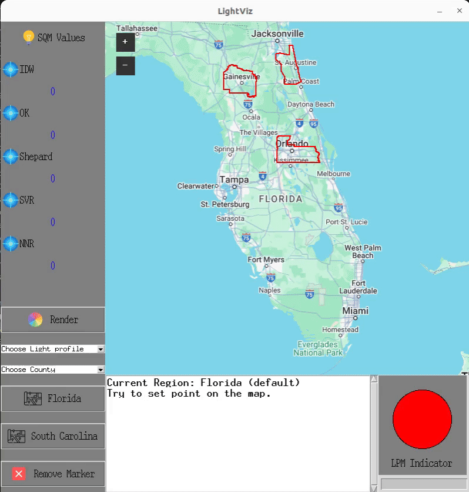
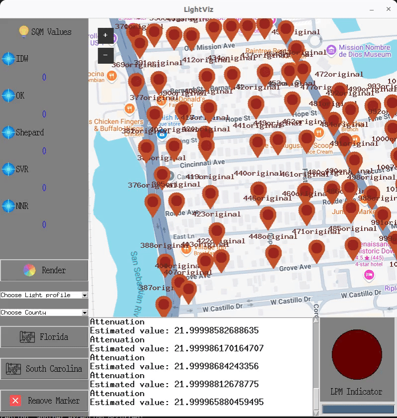

# LightTrace: Interactive Light-Pollution Visualization and Light-Footprint Monitoring

[](https://creativecommons.org/licenses/by-nc/4.0/)


LightTrace is an interactive environmental-monitoring application for collecting, modeling, visualizing, and mapping artificial light at night. It converts streetlight records and field-measured Sky Quality Meter (SQM) observations into explorable light-field maps, helping researchers, planners, and communities trace how illumination spreads across an area.

The project retains the original implementation and research foundation while presenting the application under the **LightTrace** name. It is a research prototype rather than a production monitoring service.

## Key capabilities

- **Interactive geospatial editing** — add, inspect, and remove light sources directly on a map.
- **SQM-based measurements** — record point-source brightness values for interpolation and comparison.
- **Configurable attenuation modeling** — tune the `C1` and `C2` coefficients to model how illumination decreases with distance.
- **Five interpolation approaches** — compare IDW, Ordinary Kriging, Shepard interpolation, Support Vector Regression, and Neural Network Regression.
- **County-scale rendering** — transform distributed point observations into a continuous light-field layer.
- **Built-in sample data** — experiment with streetlight datasets for St. Johns County and Alachua County, Florida.
- **Environmental decision support** — explore lighting footprints relevant to ecological conservation, dark-sky planning, infrastructure assessment, and light-pollution mitigation.

## Demo

| Add and edit a light source | Render a light-field map |
| --- | --- |
|  |  |

## How it works

```text
Streetlight records / SQM observations
                  ↓
      Geographic coordinates
                  ↓
    UTM projection and distance
                  ↓
       Light attenuation model
                  ↓
 IDW / Kriging / Shepard / SVR / NNR
                  ↓
        County-scale grid values
                  ↓
  Leaflet-based interactive heat map
```

The desktop interface is built with Python and TkinterMapView. The application projects geographic coordinates into UTM coordinates for distance-aware analysis, estimates values at unsampled locations, and passes the resulting grid to a Leaflet-based map for interactive rendering.

### Attenuation model

For a light source at distance `x`, the implementation uses an adjustable attenuation curve:

```text
attenuation(x) = 1 / (1 + C1 × x / 10 + C2 × x² / 100)
```

The `C1` and `C2` controls let users explore different falloff behaviors. The accompanying curve view translates attenuation into the SQM scale so users can preview a source model before applying it.

### Interpolation methods

| Method | Role in LightTrace | Useful when |
| --- | --- | --- |
| IDW | Weights nearby observations more heavily than distant ones | A fast, intuitive spatial estimate is needed |
| Ordinary Kriging | Uses spatial covariance to estimate unobserved values | Spatial structure and smooth regional trends matter |
| Shepard | Applies a distance-weighted interpolation formulation | A deterministic alternative to basic IDW is useful |
| SVR | Learns a nonlinear surface from sampled points | The light field may not follow a simple spatial trend |
| NNR | Fits a neural network to the observation coordinates and values | Exploring data-driven nonlinear relationships |

## Typical workflow

LightTrace supports two light-source modes: sources with attenuation and sources without attenuation. The modes should not be mixed in one analysis.

### Single-point interpolation without attenuation

1. Zoom to the desired study area.
2. Right-click and choose **Add Light Source**.
3. Enter SQM values. Use at least three observations, including samples above and below the expected intensity.
4. Select an interpolation method.
5. Left-click a target location to estimate its value.

### Single-point interpolation with attenuation

1. Right-click and choose **Add Light Source with Attenuation**.
2. Enter the source value and adjust `C1` and `C2` in the attenuation-curve window.
3. Confirm the model and close the curve window.
4. Left-click a target location to estimate its value.

### Light-field map rendering

1. Add attenuation-enabled light sources across the study area.
2. Choose the target county.
3. Select the interpolation configuration.
4. Click **Render**.
5. Inspect the generated light-field layer in the map view.

## Project structure

```text
LightTrace/
├── main.py                    # Main desktop application and interpolation workflow
├── light_attenuation.py       # Attenuation controls and SQM curve visualization
├── environment.yml            # Conda environment definition
├── src/
│   └── example_directdraw.html # Leaflet light-field rendering page
├── maps_files/                # County boundaries and sample streetlight data
├── demo/                      # Animated usage demonstrations
├── button_img/                # Interface assets
└── tkintermapview/            # Bundled map-view component used by the application
```

## Included datasets

| File | Description |
| --- | --- |
| `maps_files/st_johns_street_map_6k.csv` | Approximately 6,000 streetlights and associated profiles for St. Johns County |
| `maps_files/Alachua_street_map.csv` | Streetlight records and profiles for Alachua County |
| County boundary files in `maps_files/` | Geographic boundaries used to constrain regional rendering |

To use another study area, prepare compatible coordinates and lighting attributes, update the dataset path in `main.py`, and provide the appropriate regional boundary geometry.

## Installation

### Prerequisites

- Python 3.10
- Conda or Miniconda
- Linux GUI/build packages when required:

```bash
sudo apt install libcairo2-dev libxt-dev libgirepository1.0-dev
```

### Setup and launch

```bash
git clone https://github.com/sarahzoulinyan/LightTrace.git
cd LightTrace
conda env create -f environment.yml
conda activate lighttrace
python main.py
```

## Performance and configuration notes

- **Sparse sources may be invisible at county scale.** A streetlamp illuminates an area measured in meters, while a county-scale grid may span 20 km or more. Increase `grid_resolution` in `main.py` or add enough representative sources to sample the study area adequately.
- **High-resolution rendering can be slow.** Depending on source count, grid size, interpolation method, and hardware, a render can take a long time. Increase the `cellSize` value in `src/example_directdraw.html` to improve speed at the cost of spatial detail.
- **Displayed dark areas are color-mapped for readability.** If scientifically literal near-black output is required, review the filtering and color-mapping logic in `main.py` before analysis.
- **Machine-learning methods need adequate samples.** SVR and NNR results depend strongly on observation density, parameter selection, and spatial coverage.

## Troubleshooting

### `geocoder.osm` returns HTTP 403

See the discussion in [geocoder issue #471](https://github.com/DenisCarriere/geocoder/issues/471) for current OpenStreetMap/Nominatim request guidance.

### The rendered map is empty

Check that the selected county contains the light sources, that the boundary data loaded successfully, and that grid resolution is fine enough to sample the illuminated region.

### Rendering takes too long

Start with a smaller area, fewer sources, a coarser grid or cell size, and IDW before testing more computationally intensive methods.

### The application exits unexpectedly

This repository is an experimental research implementation. Restart the application, reproduce the smallest failing case, and record the input data, interpolation method, and error message when reporting an issue.

## Research and environmental applications

LightTrace can support exploratory work in:

- artificial-light-at-night and skyglow monitoring;
- ecological impact assessment near habitats and migration corridors;
- dark-sky conservation and outdoor-lighting policy;
- municipal streetlight auditing and retrofit planning;
- energy-efficiency studies and excessive-illumination detection;
- field-survey planning for distributed environmental sensor networks;
- before-and-after comparisons of lighting interventions.

Model output should be validated against field measurements before it is used for policy, safety, or engineering decisions.

## Research origin and citation

This implementation is based on the research described in the publication below. The original paper title is preserved here exactly for bibliographic accuracy:

> Huang, S.-E., Suhi, K. F. F., & Islam, M. J. (2025). *LightViz: Autonomous Light-field Surveying and Mapping for Distributed Light Pollution Monitoring*. Environmental Monitoring and Assessment, 197. [https://doi.org/10.1007/s10661-025-13862-5](https://doi.org/10.1007/s10661-025-13862-5)

```bibtex
@article{huang2025lightviz,
  title     = {LightViz: Autonomous Light-field Surveying and Mapping for Distributed Light Pollution Monitoring},
  author    = {Huang, Sheng-En and Suhi, Kazi Farha Farzana and Islam, Md Jahidul},
  journal   = {Environmental Monitoring and Assessment},
  volume    = {197},
  year      = {2025},
  publisher = {Springer Nature},
  doi       = {10.1007/s10661-025-13862-5}
}
```

## License

This work is licensed under the [Creative Commons Attribution-NonCommercial 4.0 International License](https://creativecommons.org/licenses/by-nc/4.0/). Review `LICENSE.txt` for the repository's license text.
